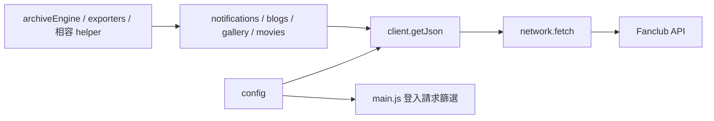

# API 與 IPC 索引

本頁將「API 節點」分為上游 HTTP 端點、桌面內部 IPC，以及本地媒體協定。以下皆以原始碼的呼叫方式為準；範例中的 `{id}`、`{page}` 等符號是佔位符。

## API 目錄與依賴方向

Fanclub API 集中在 [`src/main/api/takaneko/`](../src/main/api/takaneko/)。engine 與 exporter 呼叫資源模組，資源模組透過共用 client 發送 JSON 請求；此目錄不負責寫 archive、排程下載或操作 UI。

```text
src/main/api/takaneko/
  config.js         API origin、登入監聽 pattern、固定分類與媒體 API header
  client.js         getJson：網域檢查、Bearer、逾時與 HTTP/JSON 錯誤
  auth.js           refreshCredentials：更新登入憑證
  notifications.js  count / list / listAll / detail
  blogs.js          list / detail
  gallery.js        list / detail
  movies.js         list / detail
  index.js          四個資源模組的共用入口
```



資源方法的第一個參數是 Token。`list(token, page=1)` 回傳上游分頁物件；`detail(token, id)` 回傳詳情物件。通知的 `list(token, limit, offset=0)` 按位移分頁。`listAll(token)` 封裝總數查詢及陣列／`items`／`data` 格式相容處理。其餘清單的分頁迴圈仍由 engine 或 exporter 控制。

新增端點時，在對應資源檔組合路徑與 query，透過 `client.getJson()` 請求，再由呼叫端處理業務流程。不要在 exporter 重建 API 網域、Bearer 或 JSON request helper。既有 [getAllPosts.js](../src/main/api/getAllPosts.js) 只保留 `handleGetAllPosts()` 相容入口，委派給 `notifications.listAll()`。

## Fanclub HTTP 端點

API base URL 為 `https://api.takanekofc.com`。下表的內容請求皆為 `GET`，需要使用者具有相應存取權限的 `Authorization: Bearer <TOKEN>`。登入視窗載入的是 `https://takanekofc.com/login`，不是由本程式另行實作帳密登入 API。

| 用途 | 相對路徑與 query | 程式使用的回傳欄位 | 端點管理位置 |
| --- | --- | --- | --- |
| 通知總數 | `/auth/notifications/count?notificationType=message` | `count` 或 `total` | [notifications.count](../src/main/api/takaneko/notifications.js) |
| 通知清單 | `/auth/notifications?notificationType=message&offset={offset}&limit=50&orderType=2&readType=all` | 陣列本身，或 `items`／`data`；每項的 `notificationReservationId`、`title`／`subject` | [notifications.list / listAll](../src/main/api/takaneko/notifications.js) |
| 單篇通知詳情 | `/auth/notifications/{id}` | `title`／`subject`、`sendingOfficialUserId`、`body*`、`image*`、文字與日期欄位 | [notifications.detail](../src/main/api/takaneko/notifications.js) |
| 經理人部落格清單 | `/blog/queries/getArticleList?blogId=topics&page={page}&categories={categoryId}` | `articleList`、`totalPages`；每項的 `id`、`title` | [blogs.list](../src/main/api/takaneko/blogs.js) |
| 部落格詳情 | `/blog/queries/getArticleDetail/{id}` | `title`、`body`、`thumbnail`、`displayDate`／`createdAt` | [blogs.detail](../src/main/api/takaneko/blogs.js) |
| Gallery 清單 | `/gallery/queries/getGalleryAlbumList?page={page}&pageSize=20` | `galleryAlbumList`、`totalPages` | [gallery.list](../src/main/api/takaneko/gallery.js) |
| Gallery 詳情 | `/gallery/queries/getGalleryAlbumDetail/{id}` | `title`、`thumbnail`、`description`、`galleryAlbumItems[].file`、日期欄位 | [gallery.detail](../src/main/api/takaneko/gallery.js) |
| Movies 清單 | `/movie/queries/getMovieList?page={page}&pageSize=20` | `movieList`、`totalPages` | [movies.list](../src/main/api/takaneko/movies.js) |
| Movie 詳情 | `/movie/queries/getMovieDetail/{id}` | `movieType`、`videoId`、`thumbnail`、`title`、`description`、日期欄位 | [movies.detail](../src/main/api/takaneko/movies.js) |

`categoryId` 使用程式中固定的經理人部落格分類值，並非 UI 可設定項目。Blog／Gallery／Movie 清單從第 1 頁讀到 `totalPages`，缺少頁數時採 1；通知清單每頁 50 筆。總數查詢回傳 403 或沒有提供總數時，讀到不足一頁為止。重複的完整頁面會回報錯誤。

### 驗證與網路路徑

- `capture-token` 先從 Fanclub 登入視窗取得更新憑證，交由 [auth.js](../src/main/api/takaneko/auth.js) 對 `/auth/refresh` 發送 JSON POST。成功時一併保存 access token 與 refresh token。若無法更新，改為監聽該視窗的 Fanclub API 請求並重新載入，最多等待 15 秒。備援擷取成功時會移除舊帳號的更新憑證。
- `get-login-status` 檢查本機 access token 或更新憑證。桌面工作每次內容 API 請求前檢查 JWT 的到期時間，提前 30 秒更新。收到 HTTP 401 時可更新憑證並重送該請求一次。
- [client.getJson()](../src/main/api/takaneko/client.js) 統一透過 [network.fetch](../src/main/utils/network.js) 請求；Electron 使用 `electron.net.fetch`，Node 測試使用全域 fetch。已移除 engine／exporter 內重複的 `json`、`httpGet`、`fetchJson` helper。
- 請求限於設定的 API origin，拒絕其他網域與帶有帳密的 URL；ID 與可變 query 值會編碼。共用 client 補上需要的 Bearer 前綴，Gallery／Movie 保留原有 User-Agent。
- HTTP 必須為 `200` 並能解析 JSON。HTTP 錯誤只包含狀態碼，JSON 語法錯誤使用固定訊息，不把回應內容寫進錯誤訊息。
- 共用 timeout 預設 30 秒，涵蓋收到 headers 及讀取 JSON body；逾時中止請求並回傳 `TIMEOUT`。保留的 `handleGetPostDetails()` 批次 helper 透過 `notifications.detail(..., {timeoutMs:15000})` 維持 15 秒設定。這使原本沒有獨立 timeout 的 Gallery／Movie JSON 請求也有一致上限。

回歸測試見 [takaneko-api.test.js](../tests/takaneko-api.test.js)，涵蓋內容 HTTP 端點、認證、錯誤、逾時及 engine／相容 helper 整合；分頁與媒體匯出行為另由 [official-media.test.js](../tests/official-media.test.js) 驗證。

### 媒體來源

| 來源 | 處理方式 |
| --- | --- |
| 投稿／Blog HTML、縮圖與 Gallery 照片 URL | [downloadToFile](../src/main/api/downloadToFile.js) 串流寫入；Gallery／Movie 封面會附 Fanclub Referer 與 User-Agent |
| 投稿／Blog 的 Vimeo iframe | 解析影片 ID，交由 yt-dlp 讀取 `https://player.vimeo.com/video/{id}`；偏好 HEVC 並以 MP4 輸出 |
| Movie 的 `movieType: video` 或 `vimeo` | [movieSource](../src/main/api/exportMovies.js) 轉成 Vimeo URL，支援程式接受的 unlisted hash 格式 |
| Movie 的 `movieType: youtube` | 驗證 11 字元 ID，轉成 `https://www.youtube.com/watch?v={id}`，加入 YouTube runtime 與可選 cookies 參數 |

Movie 使用最高畫質選擇與 MP4 remux，與投稿／Blog 的轉碼參數不同。媒體 URL 來自內容 API 或解析結果，沒有固定的「所有媒體下載」REST 端點。Fanclub Token 與 YouTube cookies 用途不同；程式不把 Fanclub Authorization 自動附到每個圖片或影片來源。

## Renderer IPC

入口是 [preload.js](../src/main/preload.js) 的 `window.takaneko.invoke(channel, ...args)`。不在 allowlist 的 channel 會先丟出 `Unknown operation`，不會送進主程序。

下表中未另註的 handler 位於 [desktopV2.js](../src/main/desktopV2.js)；登入、app info、控制旗標與開啟下載資料夾位於 [main.js](../src/main/main.js)。呼叫皆回傳 Promise；有些 handler 回傳錯誤物件，有些會 reject，呼叫端不能只檢查 `success`。

### 應用程式、登入與設定

| Channel | 引數 | 回傳／效果 |
| --- | --- | --- |
| `get-app-info` | 無 | `{name, version}` |
| `get-login-status` | 無 | 本機是否有可用的 access token 或更新憑證 |
| `open-login` | 無 | 開啟或聚焦 Fanclub 登入視窗，清除登入或下載期間回傳 `{success:false}` |
| `clear-login-cookies` | 無 | 關閉登入視窗並清除 Fanclub 登入資料，回傳 `{success:true,removed}`。工作進行中回傳 `{success:false}` |
| `capture-token` | 無 | 成功 `{success:true}`；失敗 `{success:false}`；成功後關閉登入視窗 |
| `get-download-settings` | 無 | `{concurrency, blogs, gallery, movies, needsMigration}` |
| `save-v2-settings` | `{concurrency, blogs, gallery, movies}` | 儲存並回傳正規化設定；併發範圍 1–100，無效數值預設 5 |
| `get-folder-settings` | 無 | `{downloadRoot, readerRoot}`，包含預設路徑解析結果 |
| `download-folder-select` | 無 | 原生目錄選擇；`{saved:true}`／`{cancelled:true}`／`{error:'LOCATION_BUSY'}`；檔案系統錯誤可 reject |
| `open-exported-folder` | 無 | 必要時建立下載資料夾，呼叫 `shell.openPath`，回傳路徑 |
| `youtube-cookies` | 無，或 `{action:'save',content}`／`{action:'remove'}` | `{configured:boolean}`；格式或儲存失敗可 reject；不回傳 cookies 原文 |
| `open-youtube-help` | `'guide'` 或 `'extensions'` | 開啟程式固定的說明連結；未知 key 不執行操作 |

`get-download-settings` 在 `main.js` 有初始 handler，但 `desktopV2.setup()` 會先移除再以目前版本取代。應以後者的回傳契約為準。

### 下載與控制

| Channel | 引數 | 回傳／效果 |
| --- | --- | --- |
| `start-download` | 無；從 Store 讀取設定 | 已有工作或正在處理登入：`{success:false,status:'busy'}`；沒有 Token：`loginRequired`；正常結束：`{success,status,progress}`，status 為 `completed`／`failed`／`cancelled`／`loginRequired`；外層例外：`{success:false,status:'failed'}` |
| `control-pause` | 無 | 設定 `state.isPaused=true`，回傳 `true` |
| `control-resume` | 無 | 設定 `state.isPaused=false`，回傳 `true` |
| `control-cancel` | 無 | 設定取消並清除暫停旗標，回傳 `true` |
| `get-download-errors` | 無 | 最近保存的診斷陣列，沒有資料時為 `[]` |

`start-download` 的 Promise 在整個工作結束後才回傳；中途進度走獨立的 `job-progress` 事件。控制 handler 的 `true` 只表示已寫入旗標，不代表所有進行中的 I/O 已停止。

### Reader 與 archive 操作

`mode` 只有字串 `'reader'` 會選擇自訂來源 Reader，其餘值落到 `'local'`。目前 UI 統一傳 `'reader'`。

| Channel | 引數 | 回傳／效果 |
| --- | --- | --- |
| `reader-select` | 無 | 原生目錄選擇；取消回傳 `null`，否則保存來源並回傳掃描 summary |
| `reader-scan` | `mode` | 首次初始化或重新掃描，回傳 `{root,count,unavailable,warnings}` |
| `reader-query` | `mode, options` | summary 加上 `{rows,total,hasMore,members}`；每頁固定 48 件 |
| `reader-detail` | `mode, key` | 投稿詳情、`bodyAvailable` 與媒體陣列；找不到投稿時為 `null` |
| `archive-action` | `mode, action, id` | `save-media`／`save-post`：原生選擇目的地並複製；`reveal-media`／`reveal-post`：在檔案管理員顯示來源 |

`reader-query` options：`member` 與 `kind` 做等值篩選，`multimedia` 決定投稿或媒體模式，`type` 在媒體模式使用 `all`／`image`／`video`，`offset` 為起始位置。回傳資料中的媒體包含 `{id,postKey,mime,variant,available,url}`；URL 為 `archive://media/{id}`，不暴露媒體實體檔案路徑。

`archive-action` 的 `id` 是已索引的 post key 或 media ID，不能傳任意來源路徑。成功回傳 `{saved:true}` 或 `{opened:true}`，取消為 `{cancelled:true}`；錯誤物件代碼為 `SOURCE_READ_ONLY`、`ARCHIVE_UNAVAILABLE` 或 `INVALID_ACTION`。

### 未暴露給目前 renderer 的 handler

`main.js` 還註冊 `get-token`、`save-token`、`save-download-settings`、`get-exported-path`，但它們不在 preload allowlist。這些不是目前 UI 的可用 API；新增功能應先確認是否可沿用現行介面，而非直接呼叫這些名稱。

## 進度事件與診斷格式

訂閱方式為 `window.takaneko.onProgress(callback)`；preload 接收 `job-progress` 後，只把 payload 傳給 callback。

```js
// 合成的進度範例，數值以投稿／相簿／影片項目計算。
{
  list:    {done: 3, total: 3, failed: 0, skipped: 0, state: 'completed'},
  details: {done: 2, total: 3, failed: 0, skipped: 1, state: 'running'},
  files:   {done: 1, total: 3, failed: 0, skipped: 1, state: 'running'},
  errors: []
}
```

- `total:null` 表示尚未得知總量。stage state 使用 `waiting`、`running`、`completed`、`failed`、`cancelled`；沒有獨立的 `paused` 進度狀態。
- `done` 包含成功、跳過與已處理的失敗，因此要搭配 `failed`、`skipped` 與 `state` 判讀。
- 診斷格式為 `{itemId,kind,stage,code}`，由 [downloadErrors.js](../src/main/utils/downloadErrors.js) 正規化；不把完整例外訊息或工具 stderr 送進工作歷史。
- 常見 code：`HTTP_403` 等 HTTP 狀態、`TIMEOUT`、`NETWORK_ERROR`、`FILE_IO_ERROR`、`MEDIA_TOOL_NOT_FOUND`、`MEDIA_TOOL_FAILED`、`MEDIA_ACCESS_DENIED`、`DOWNLOAD_FAILED`。Movie 可保留 `cover`／`video`／`save` 等階段診斷。
- [UI.errors](../src/shared/ui.js) 最多顯示前 50 筆；Store 保存的是主程序收到的診斷陣列。

## 本地媒體協定

`archive://media/{mediaId}` 是 Electron 自訂協定，不是 HTTP server。handler 位於 [desktopV2.js](../src/main/desktopV2.js)。

| 條件 | 結果 |
| --- | --- |
| hostname 為 `media`、ID 為 64 位小寫十六進位字元、方法為 `GET`／`HEAD` | 查找已索引媒體，再以 `reader.resolve()` 檢查檔案 |
| 沒有 Range | `200`，完整長度與 MIME type；`HEAD` 沒有 body |
| 有效的單一 `bytes=start-end`、`bytes=start-` 或 `bytes=-length` | `206`，含 `Content-Range`，支援影片區段讀取 |
| 格式錯誤或超出可讀範圍的 Range | `416`，含 `Content-Range: bytes */{size}` |
| 未知媒體、非法路徑、讀取失敗或不支援的方法 | `404` |

成功回應包含 `Accept-Ranges: bytes` 與 `Cache-Control: no-store`。每次取檔都重新檢查實際路徑；索引曾經成功不等於之後檔案一定仍可讀取。
