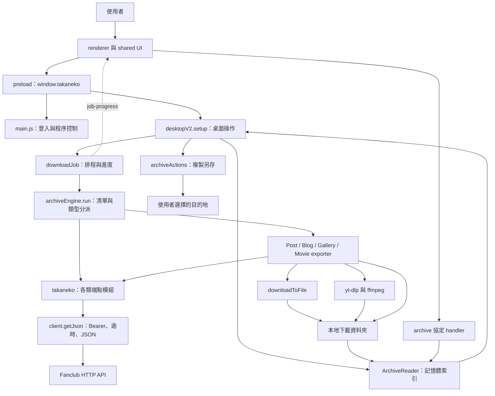
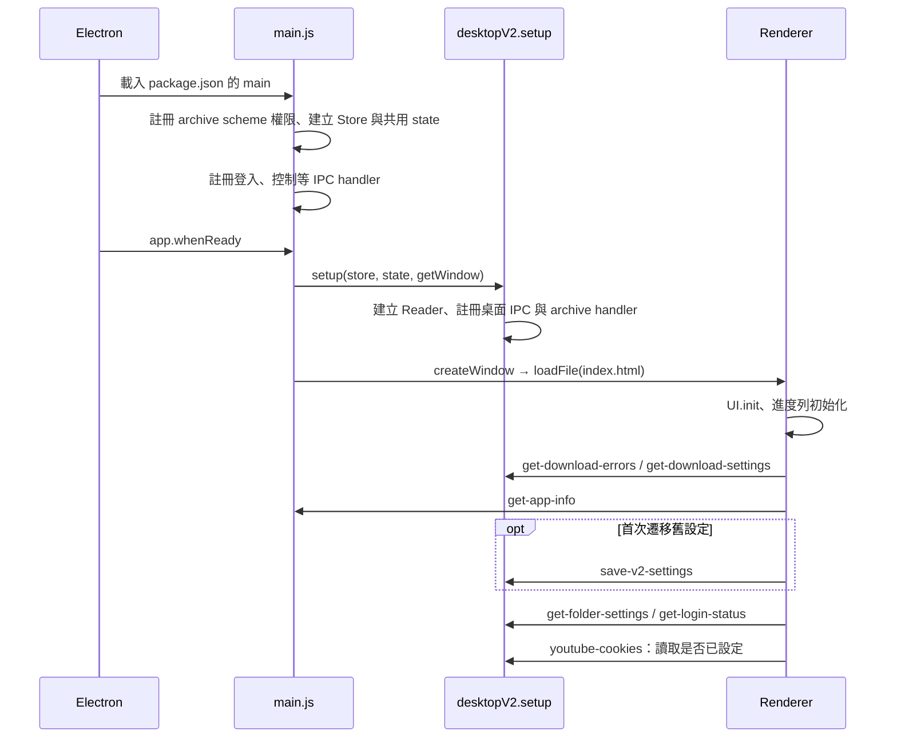

# 程式整體流程

## 架構與責任

應用程式由 Electron 主程序管理登入、下載、檔案與原生對話框；renderer 負責畫面及互動。renderer 透過 `window.takaneko` 呼叫 allowlist 內的 IPC，媒體則使用 `archive://` 自訂協定讀取。

| 模組 | 責任 |
| --- | --- |
| [main.js](../src/main/main.js) | 註冊協定權限、建立視窗、登入與 Token 擷取、共用暫停／取消旗標 |
| [desktopV2.js](../src/main/desktopV2.js) | 註冊目前 UI 使用的桌面 IPC、下載互斥鎖、Reader 實例、檔案對話框、媒體串流 |
| [downloadJob.js](../src/main/downloadJob.js) | 清單去重、跳過既有投稿、worker 併發、三階段進度及錯誤彙整 |
| [archiveEngine.js](../src/main/api/archiveEngine.js) | 將統一的工作項目分派到各內容類型的 exporter，確認完成標記 |
| [api/takaneko/](../src/main/api/takaneko/) | 集中管理 API origin、登入請求篩選、分類值、各類端點與共用 JSON 請求 |
| [local-reader/index.js](../src/main/local-reader/index.js) | 只讀掃描、格式驗證、篩選分頁、檔案與符號連結邊界檢查 |
| [renderer.js](../src/renderer/renderer.js) | 分頁、篩選、詳情、下載按鈕與原生操作結果呈現 |

## 啟動順序

主視窗使用 `nodeIntegration: false`、`contextIsolation: true`、`sandbox: true`，並阻止新視窗及主視窗導向。`preload.js` 只暴露 `invoke()` 與 `onProgress()`。YouTube 設定面板的狀態載入獨立啟動，沒有等待前述初始化全部結束。

關閉所有視窗時，非 macOS 平台結束程式；macOS 保留程序，收到 `activate` 且沒有視窗時重建主視窗。程式沒有把下載工作佇列序列化成可在重啟後直接續跑的任務；重新開始下載時，依既有 archive 跳過已完成項目。

## 下載主路徑

1. UI 先儲存下載設定，再呼叫 `start-download`。
2. `desktopV2` 檢查是否已有工作、是否有 Token，鎖定工作並重設暫停／取消旗標。
3. `downloadJob` 經由 engine 呼叫 `takaneko` 資源模組，取得通知及已啟用的 Blog／Gallery／Movie 清單，以 `kind:id` 去重。
4. Reader 掃描下載位置，建立可跳過的既有投稿集合。
5. worker 透過 `archiveEngine.run({action:'download', ...})` 取得詳情及媒體；成功寫入 `.post-id` 才視為完成。
6. 主程序推送 `job-progress`，UI 更新清單、詳情、檔案三條進度與錯誤列表。
7. 工作結束後回傳狀態、觸發本地下載索引重建，並解除工作鎖。

「檔案」進度以工作項目數計算，一個相簿或一篇投稿算一項，不是位元組數或媒體檔案數。詳情與檔案階段在 worker 中重疊進行，不是全體詳情完成後才開始所有檔案。細節見 [核心處理函式流程](core-processing.md)。

## 閱讀主路徑

`desktopV2` 保留 `local` 與 `reader` 兩個 Reader 實例；目前 renderer 的 `readerMode()` 固定回傳 `reader`，因此內容瀏覽、多媒體瀏覽及本地閱讀器共用 `readerRoot`，未設定時使用下載位置。

```mermaid
flowchart LR
    Select[選擇來源或使用預設來源] --> Scan[select / scan]
    Scan --> Memory[記憶體 posts 與 media 索引]
    Memory --> Query[query：篩選及每頁 48 件]
    Query --> Cards[列表卡片]
    Cards --> Detail[detail：重讀文字與檢查媒體]
    Detail --> URL[archive://media/媒體ID]
    URL --> Safe[safeFile 邊界檢查]
    Safe --> Stream[本地檔案串流]
```

索引只接受已完成下載與本程式另存的 v2 投稿；格式詳見 [Reader 文件](../src/main/local-reader/README.md)。來源根目錄無法讀取時會清空舊索引。進入集合頁面、手動重新整理，以及符合條件的每 60 秒輪詢會掃描；篩選與翻頁只查記憶體索引。

## 狀態與資料的生命週期

| 資料 | 位置／生命週期 |
| --- | --- |
| Fanclub Token、下載設定、資料夾選擇、最近錯誤 | Electron `userData` 下的 `electron-store`；錯誤保存為代碼與來源識別資訊 |
| YouTube cookies | `userData/youtube-cookies.txt`；每次 YouTube 工具呼叫建立獨立暫存副本，結束後移除副本 |
| 下載內容 | 使用者選擇的 `downloadRoot`；預設為 `userData/exported` |
| 瀏覽來源 | `readerRoot`；未設定時跟隨下載位置，不會因更改位置而搬移內容 |
| 語言與舊 UI 偏好 | renderer 的 `localStorage`；舊內容開關在需要時遷移到主程序設定 |
| Reader 索引、工作鎖、暫停／取消旗標 | 主程序記憶體，不是持久化工作佇列 |

## 目前實作邊界

- `getPostDetails.handleGetPostDetails` 與 `exportPosts.handleExportPosts` 是保留的批次 helper；目前 UI 主流程不呼叫它們。`getAllPosts.handleGetAllPosts` 保留為 `notifications.listAll()` 的相容入口。一般投稿由 engine 呼叫 `notifications.detail()`，再呼叫 `processSinglePost(..., true)`。
- 主程序仍註冊少數未加入 preload allowlist 的 handler；不能因為看到 `ipcMain.handle` 就認定目前 renderer 能呼叫，詳見 [API 索引](api-reference.md)。
- 暫停／停止是共用旗標與檢查點，不會立即中止所有 HTTP 串流或外部程序。
- [videoQueue.js](../src/main/utils/videoQueue.js) 的兩個 slot 限制只用於非 Electron 執行環境；Electron 路徑直接執行 callback。目前 UI／README 的「影片同時最多 2 個」文字與這段實作不一致，不能用該文字推斷桌面端已有全域兩影片限制。
