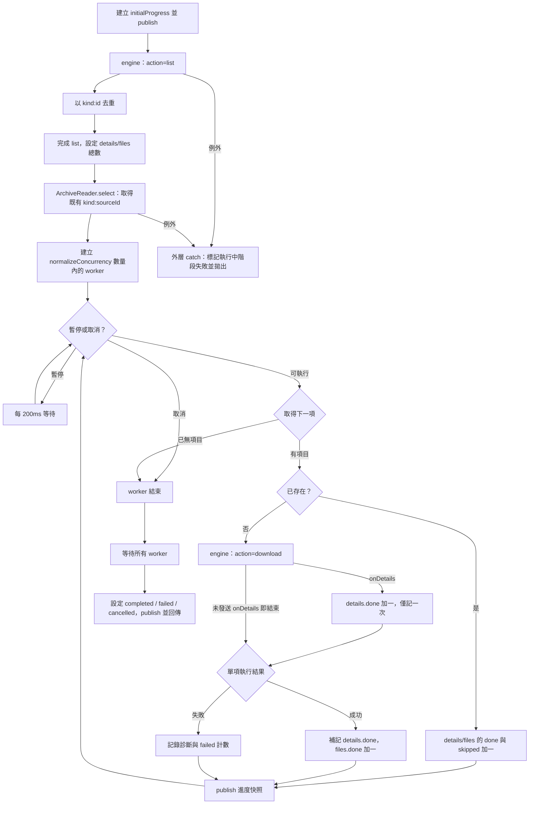
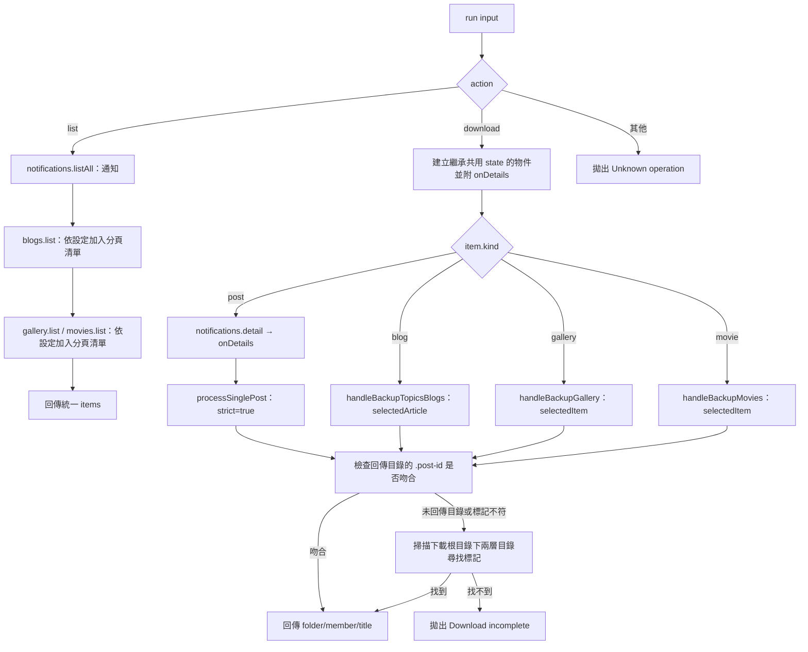
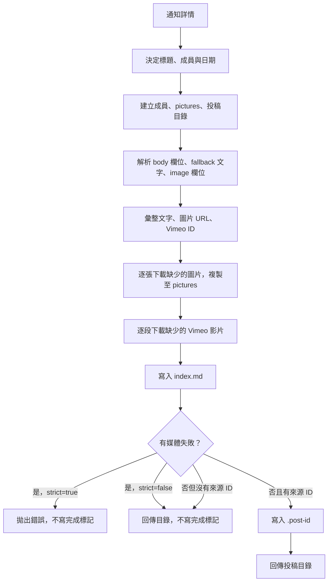
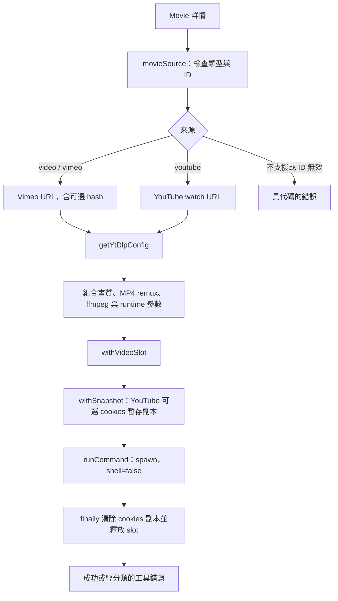
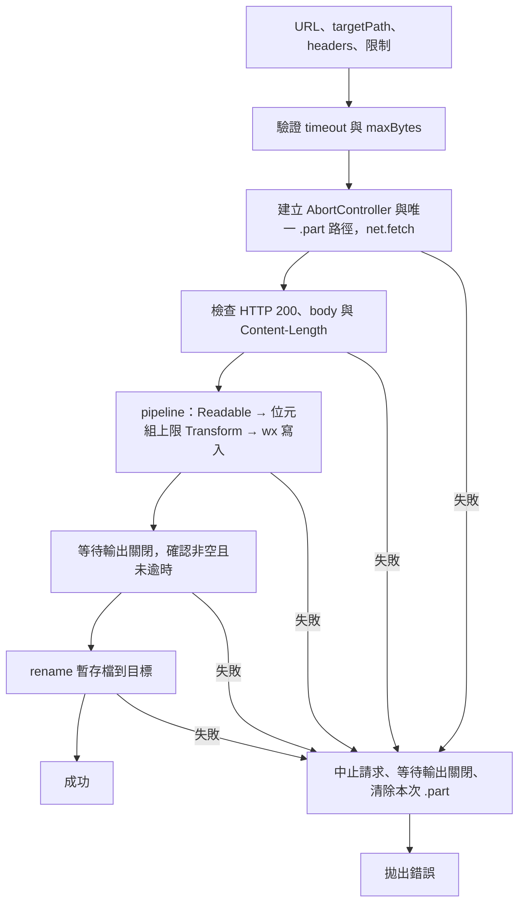
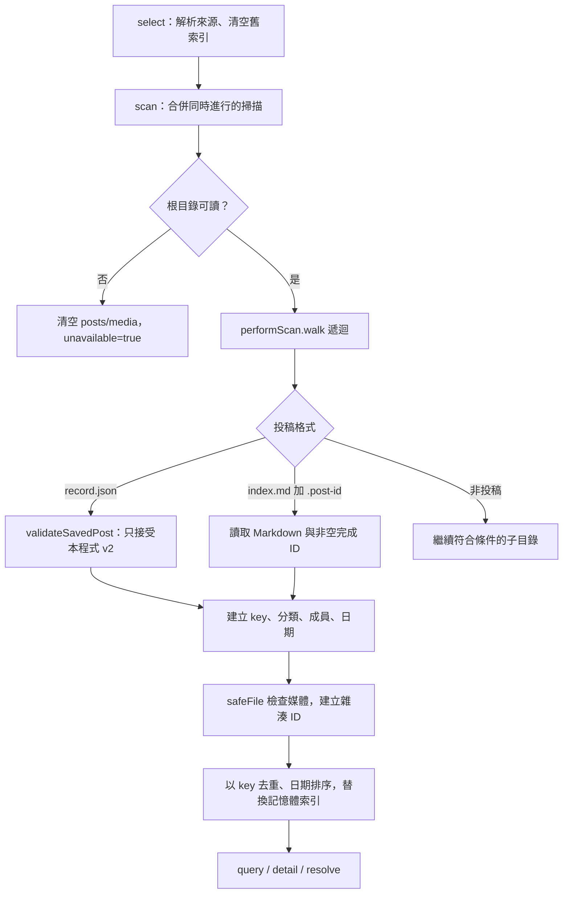

# 核心處理函式流程

本頁追蹤目前桌面 UI 會走到的核心路徑。API 欄位與 IPC 契約見 [API 索引](api-reference.md)，操作時序見 [互動流程](interaction-flow.md)。

## 1. `downloadJob()`：工作排程與進度

原始碼：[downloadJob.js](../src/main/downloadJob.js)。輸入為 `{token,getToken,directory,settings,state,emit,engine=run}`；`engine` 可注入，方便用合成資料測試排程。

桌面工作透過 `getToken` 在每個內容請求前確認憑證與暫停／取消狀態。清單期間取消會回傳 `cancelled`，失去登入憑證時回傳 `loginRequired`。每個 worker 共用遞增的 `cursor`。併發設定由 [normalizeConcurrency](../src/main/utils/concurrency.js) 正規化到 1–100，預設 5，實際 worker 數不超過項目數。

`publish()` 使用 JSON 複製進度，避免 callback 看到之後被改寫的同一物件。詳情取得事件只記一次；若 engine 成功但沒有發送事件，結尾補記。若詳情前失敗，details 與 files 都記失敗；若詳情後失敗，只有 files 記失敗。外層例外會以 `list` 階段整理診斷，即使例外實際出現在後續初始化；這是目前 catch 的行為。

既有項目集合來自 Reader 成功索引到的投稿，不是單純檢查目錄名稱。已索引項目會跳過詳情及檔案工作；這不是重新驗證或修復所有既有媒體的流程。重新按「下載開始」會重新取清單、跳過已完成投稿，再嘗試未完成項目；沒有另外的「只重試錯誤 ID」IPC。

## 2. `archiveEngine.run()`：統一項目與 exporter 分派

原始碼：[archiveEngine.js](../src/main/api/archiveEngine.js)。清單結果統一為 `{kind,id,title}`，`kind` 為 `post`、`blog`、`gallery`、`movie`。

所有 Fanclub JSON 請求都經由 [api/takaneko](../src/main/api/takaneko/index.js) 資源模組。engine 保留清單分頁與類型分派，資源模組負責 URL／query，共用 [client.getJson](../src/main/api/takaneko/client.js) 負責 Bearer、HTTP／JSON 錯誤與逾時；exporter 不再內建 HTTP helper。

圖中為主要控制流程；檔案讀取等例外會直接向上傳遞。`state` 透過 prototype 繼承暫停／取消旗標，並為每項下載附上 `onDetails`，因此各 exporter 可以回報同一種詳情事件。Blog／Gallery／Movie 收到指定項目時不再重新抓整份清單。

## 3. `processSinglePost()`：一般投稿

原始碼：[exportPosts.js](../src/main/api/exportPosts.js)。目前 engine 使用 `processSinglePost(data, rootPath, true)`。

成員先查 sender ID 對照，再從標題與內容推測，最後使用營運名稱。日期依序取 `releaseDate`、`displayDate`、`publishedAt`、`createdAt`、`sentAt`；缺少或無效時保留未知日期，檔名前綴使用來源 ID 摘要避免同名碰撞。

`htmlToMarkdown()` 使用 Cheerio 擷取段落文字、`img` 與 Vimeo iframe，並非通用 HTML-to-Markdown 轉換器。投稿資料夾中的檔案供 Reader 使用；`pictures/` 是額外圖片副本，Reader 會跳過它。

下載失敗可能仍留下 `index.md` 與已成功媒體，但沒有 `.post-id` 的資料夾不會被當成完成投稿。一般投稿／Blog 的既有媒體多以「檔案存在」判斷是否跳過，不提供每次下載都重新核對內容或雜湊的保證。

## 4. Blog、Gallery、Movie 處理差異

| 函式 | 主要流程 | 完成判斷 |
| --- | --- | --- |
| [handleBackupTopicsBlogs](../src/main/api/exportBlogs.js) | 掃描既有 ID → 指定文章或分頁清單 → 詳情 → `onDetails` → `parseBlogBody` → 圖片／Vimeo → Markdown | 媒體皆無失敗才寫 `.post-id`；目前單項模式有失敗就拋出 |
| [handleBackupGallery](../src/main/api/exportGallery.js) | 指定相簿或分頁清單 → 詳情 → `onDetails` → 含 ID 摘要的目錄 → 封面 → 逐張相片 → Markdown | 驗證 `galleryAlbumItems` 為陣列；任何圖片失敗不寫標記 |
| [handleBackupMovies](../src/main/api/exportMovies.js) | 指定影片或分頁清單 → 詳情 → `onDetails` → 封面 → `movieSource` → yt-dlp → Markdown | `video.mp4` 必須非空，封面等診斷也會阻止寫入標記 |

Gallery／Movie 的目錄包含來源 ID 摘要，避免同標題互相覆蓋。Movie 封面失敗後仍可能繼續下載影片，最後以診斷回報整項失敗；不能只看到影片檔就認定投稿已完成。

### Movie 影片子流程

[mediaTools.js](../src/main/utils/mediaTools.js) 在 Windows／macOS 尋找對應 bundled yt-dlp、ffmpeg、ffprobe、Deno；正式包缺少工具會拋錯，開發環境可退回 PATH。YouTube bundled 路徑使用 Deno，PATH fallback 使用 Node runtime 參數。

[withVideoSlot](../src/main/utils/videoQueue.js) 在非 Electron 環境才限制同時兩項；Electron 直接執行 callback。投稿與 Blog 也呼叫這個 helper，但其影片策略是 HEVC 偏好與轉碼，不能套用 Movie 的 remux 描述。

## 5. `downloadToFile()`：圖片串流與原子寫入

原始碼：[downloadToFile.js](../src/main/api/downloadToFile.js)。預設 timeout 30 秒、大小上限 100 MiB；不處理影片下載。

串流限制同時檢查宣告長度及實際收到的位元組，即使沒有 `Content-Length` 仍有上限。暫存檔與目標位於同一目錄，成功前不覆蓋既有目標；失敗清理只針對本次建立的暫存檔。

## 6. `ArchiveReader`：掃描、查詢與安全解析

原始碼：[local-reader/index.js](../src/main/local-reader/index.js)。

此圖濃縮了逐目錄迴圈；實作中會先累積所有結果，再一次替換索引。

- `walk()` 最多深入 30 層，跳過符號連結目錄、隱藏目錄、`pictures`、`node_modules` 與 `.part` 目錄。遇到 `record.json` 後不再深入該投稿的子目錄。
- `safeFile()` 同時確認字面路徑與 `realpath` 都在來源根目錄內，且目標為一般檔案。子目錄或投稿讀取失敗累計 `warnings`；根目錄不可讀則清空全部索引。
- `query()` 只讀記憶體並回傳 48 件分頁。`detail()` 重讀 Markdown 與重新檢查媒體；`resolve()`／`resolvePost()` 在串流或另存前再次檢查檔案。
- `dateFromBody()` 將無時區的 Markdown Date 視為 JST；缺少或無效時為 `null`。保存的 v2 record 使用 `published_at`。一般產生的有效日期按新到舊排序，未知日期在後。

## 7. `saveMedia()`／`savePost()`：複製另存

原始碼：[archiveActions.js](../src/main/archiveActions.js)。

| 函式 | 處理順序 |
| --- | --- |
| `saveMedia(reader, mid, destination)` | `reader.resolve` → `destinationOutsideArchive` 檢查目的地 → 複製到唯一暫存檔 → rename 成目標 → finally 清理暫存檔 |
| `savePost(reader, key, parent)` | `resolvePost` → 目的地必須在來源外 → resolve 每個 original 媒體 → 建立隱藏 staging 目錄 → 只複製選定文字及媒體 → 產生 `record.json` v2 → rename 發布完整目錄 → finally 清理 staging |

另存投稿保留原 `resource_key`、來源 ID、分類、成員與發布時間，使用標題、key 摘要及隨機後綴產生新目錄。缺少必要來源檔案會使操作失敗；不遞迴複製無關內容或憑證。來源內的目的地回報 `SOURCE_READ_ONLY`。

## 暫停、取消與驗證範圍

暫停／取消會在 `downloadJob` 分派下一項前被檢查；Gallery 另在相簿與每張照片前檢查，Movie 在每項前檢查。Blog 有取消檢查，但其單項媒體迴圈沒有暫停檢查；目前一般投稿 `processSinglePost` 不接收 state。清單收集也沒有貫穿所有請求的取消 signal。已啟動的圖片串流、yt-dlp 程序或等待中的影片 callback 不會因按鈕立即終止。

| 回歸測試 | 覆蓋重點 |
| --- | --- |
| [takaneko-api.test.js](../tests/takaneko-api.test.js) | 端點／query、ID 編碼、Bearer、通知回傳格式、HTTP／JSON 失敗、逾時、engine 與相容入口整合 |
| [progress.test.js](../tests/progress.test.js) | 三階段進度、跳過、失敗、停止後不再排新項目 |
| [download-core.test.js](../tests/download-core.test.js) | 併發、網路 adapter、非 Electron 影片 slot、投稿完成標記 |
| [downloadToFile.test.js](../test/downloadToFile.test.js) | 串流、HTTP 失敗、大小限制、逾時、清理與原子寫入 |
| [official-media.test.js](../tests/official-media.test.js) | 官方媒體清單、Gallery 重試、Movie 來源與診斷 |
| [reader.test.js](../tests/reader.test.js)、[archive-actions.test.js](../tests/archive-actions.test.js) | 格式、唯讀來源、路徑邊界、另存往返 |
| [media-tools.test.js](../tests/media-tools.test.js)、[youtube-cookies.test.js](../tests/youtube-cookies.test.js) | 工具選擇、cookies 範圍與暫存副本 |
| [undated-posts.test.js](../tests/undated-posts.test.js)、[time-display.test.js](../tests/time-display.test.js) | 未知日期、檔名碰撞處理、JST 顯示 |
