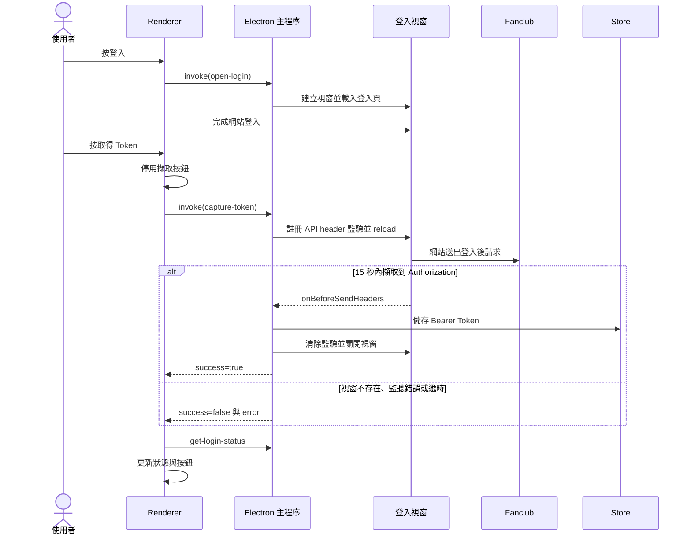
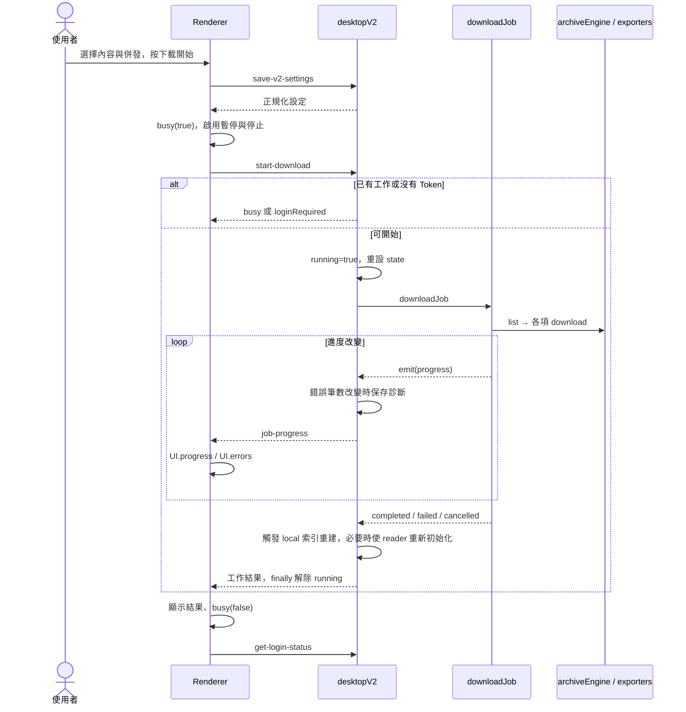
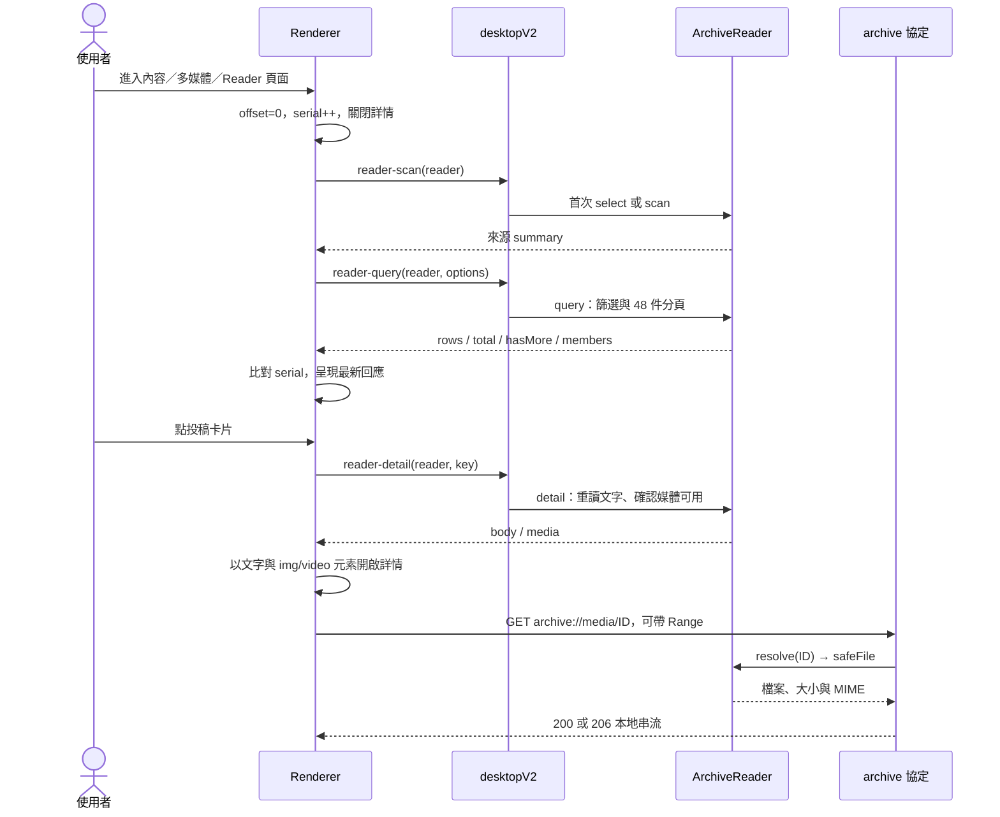
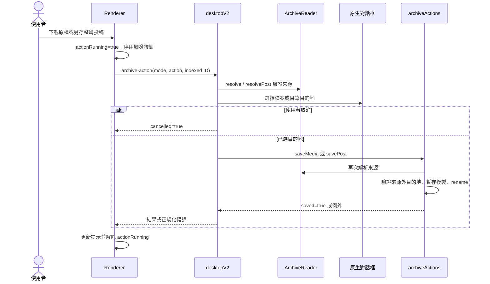

# 使用者互動流程

主畫面事件位於 [renderer.js](../src/renderer/renderer.js)，橋接位於 [preload.js](../src/main/preload.js)，桌面操作位於 [desktopV2.js](../src/main/desktopV2.js)。下列時序以目前 UI 的實際呼叫順序為準。

## 1. 登入與取得 Token

UI 不取得 Token 原文，只接收擷取結果及是否已設定。畫面上的「已登入」表示 Store 有 Token；實際有效性與內容權限要等下載 API 請求才能確認。

## 2. 下載、進度與重試

`job-progress` 事件由 preload 的 `onProgress()` 傳入 UI，與尚未結束的 `start-download` Promise 並行。一般成功、失敗或取消的回傳可能含完整 progress；主程序外層 catch 只回傳簡化的失敗狀態。

目前 renderer 將 `completed` 顯示為完成、`cancelled` 顯示為停止，其餘 status 都顯示下載失敗，沒有為 `busy` 與 `loginRequired` 各自提供不同的結果提示。

重試方式是再次按下載開始；會重建清單，依 Reader 索引跳過已完成項目，再處理未完成項目。先前成功檔案保留，但不是從持久化工作佇列恢復執行。

### 暫停與停止

| 操作 | Renderer | 主程序與核心效果 |
| --- | --- | --- |
| 暫停 | 切換本地 `paused`，按鈕變為繼續 | `control-pause` 設定旗標，worker 在檢查點等待 |
| 繼續 | 切換 `paused`，按鈕變為暫停 | `control-resume` 清除暫停旗標 |
| 停止 | 呼叫 `control-cancel`，等待工作回傳 | 設定取消並清除暫停；停止後續排程，既有 I/O 依自身流程結束 |

這些不是立刻殺掉外部程序的控制。進度 payload 沒有獨立 paused state，且不同 exporter 的檢查點不同；詳見 [核心流程的取消說明](core-processing.md#暫停取消與驗證範圍)。

## 3. 瀏覽、篩選與媒體播放

`load()` 的 `serial` 用來忽略過時查詢結果；`indexingState()` 管理掃描提示及 `aria-busy`，掃描期間停用重新整理和選來源按鈕。投稿文字用 `textContent` 呈現，不直接把 archive 內文當可執行 HTML 插入。

| 互動 | 實際呼叫與行為 |
| --- | --- |
| 內容瀏覽 | 使用投稿模式，不顯示媒體種類切換 |
| 多媒體瀏覽 | 預設 `multimedia=true,type='all'`，可篩選圖片／影片 |
| 本地閱讀器 | 同一 Reader 來源，可使用投稿或媒體模式 |
| 成員／分類／模式改變 | `offset=0`，`load()` 查詢記憶體索引，不強制掃描 |
| 上／下一頁 | offset 每次減／加 48，再查詢 |
| 點媒體卡片 | `showMedia()` 直接使用目前 rows；「查看投稿」才呼叫 `reader-detail` |
| 詳情中的上一個／下一個媒體 | 只移動目前頁面的媒體，不跨頁自動載入 |
| 手動更新 | `load(true)`：掃描後查詢 |
| 自動更新 | 每 60 秒，僅集合頁面開啟、沒有索引作業且詳情視窗關閉時執行 |
| 關閉詳情 | 清除媒體元素，釋放目前播放器 |

來源不可讀時顯示提示；媒體缺失時顯示無法讀取，停用該媒體的另存及顯示位置按鈕。若檔案在呈現後才消失，媒體元素的 error handler 仍會顯示失敗。

## 4. 另存與開啟檔案位置

「下載原檔」在這裡是複製已下載的本地檔案，不重新向 Fanclub 抓取。「開啟原檔資料夾／投稿資料夾」則經由 `resolve()`／`resolvePost()` 後呼叫 `shell.showItemInFolder()`。

UI 用 `actionRunning` 阻止另一項 archive 操作同時開始。主程序不接受 renderer 提供任意來源檔案路徑；目的地由原生對話框選擇，實際安全檢查仍由 `archiveActions` 執行。

## 5. 設定、來源與語言

| 操作 | 流程與限制 |
| --- | --- |
| 儲存下載設定 | `save()` → `save-v2-settings` → 主程序正規化併發、儲存三種內容開關 → 回填正規化值；一般投稿固定加入清單 |
| 更改下載位置 | `download-folder-select` 在對話框前後都檢查 `running` → `realpath` 與可寫檢查 → 儲存設定、使相關 Reader 重新初始化；不搬移既有檔案 |
| 更改瀏覽來源 | `reader-select` → 原生選擇 → 保存 `readerRoot` 並掃描 → UI 重設 offset/serial、更新資料夾文字；目前 handler 不立即呼叫 `load()` 重畫列表，後續進入集合頁、手動或定時更新才查詢新來源 |
| 切換語言 | [UI.init](../src/shared/ui.js) 保存 `localStorage.language`，翻譯 UI 並送出 `languagechange`；renderer 重畫進度、詳情時間與目前集合，內容本身不翻譯 |
| 時間呈現 | `UI.publicationTime()` → `UI.date()`，兩種語言都使用 JST／24 小時制，未知日期維持未知 |

### YouTube cookies

[mountYouTubeSettings](../src/shared/youtube-settings.js) 接受貼上或讀取文字檔，送出 `youtube-cookies({action:'save',content})`。主程序的 [normalize](../src/main/utils/youtubeCookies.js) 驗證 Netscape 格式、大小與欄位，只保留接受範圍內且未過期的 YouTube cookies，再以暫存檔 rename 儲存。

成功後清空輸入，畫面只顯示是否已設定；「已儲存」不代表已驗證影片存取。移除操作刪除保存檔案。下載 YouTube Movie 時，`withSnapshot()` 建立獨立副本供 yt-dlp 使用，finally 清除；正在執行的工具已取得副本，因此之後移除主設定檔不會撤回該副本。

## 相關驗證入口

互動相關回歸測試包括 [desktop-settings.test.js](../tests/desktop-settings.test.js)、[archive-actions.test.js](../tests/archive-actions.test.js)、[time-display.test.js](../tests/time-display.test.js) 與 [youtube-cookies.test.js](../tests/youtube-cookies.test.js)。實際 Electron 畫面與啟動檢查由 [smoke-desktop.js](../scripts/smoke-desktop.js) 執行：`npm run test:desktop`，需要可啟動 Electron 的環境。
